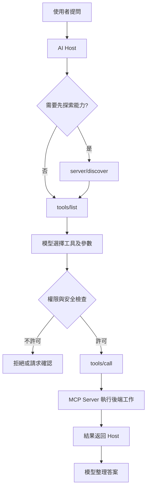

# 一次 MCP Tool Call 會發生什麼事？

> 以下是依 `2026-07-28` 架構整理的**概念流程**，不是已執行的封包擷取。實際請求可能省略預先 discover，順序也受 Host 的實作與權限策略影響。[S02](../raw/s02-architecture.md) [S03](../raw/s03-server-concepts.md)

## 情境

使用者說：「幫我列出這個 GitHub 專案待處理的 Issues，並摘要。」假設已連接合適的 MCP Server。

1. **Host 準備連線**：管理與 GitHub MCP Server 相連的 Client，取得或知道可用功能資訊。
2. **（視情況）能力探索**：Client 可發 `server/discover` 獲取支援版本與能力；不是每次都必須預先做。
3. **列出 Tools**：Client 發 `tools/list`，Server 回傳可用工具定義與參數 schema。
4. **模型選擇功能**：Host 把適合的工具描述提供給模型；模型依使用者要求選擇工具及參數。
5. **權限／安全檢查**：Host / Server 依設定處理使用者同意與存取權限，不能把信任全部交給模型。
6. **執行 Tool**：Client 發 `tools/call`，Server 可能在背後呼叫 GitHub API。
7. **工具結果回傳**：Server 回覆，Host 把結果提供給模型生成摘要，並保留操作紀錄。

## 概念陷阱

- 不是模型直接繞過 Host 連到 Server；常見架構是 Host 協調並透過 Client 執行。
- `tools/list` 只是在發現工具，**不是**真的執行工具；執行通常用 `tools/call`。
- tool call 不保證成功、不保證安全，也可能因為權限或網路問題失敗。

## 延伸

[[architecture]]、[[primitives]]、[[protocol-2026]]、[[security]]。來源：[S02](../raw/s02-architecture.md)、[S03](../raw/s03-server-concepts.md)。
