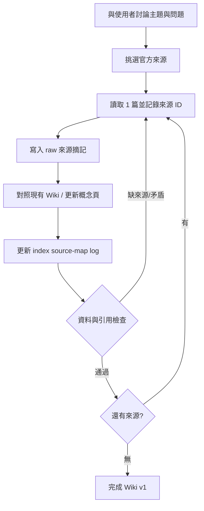
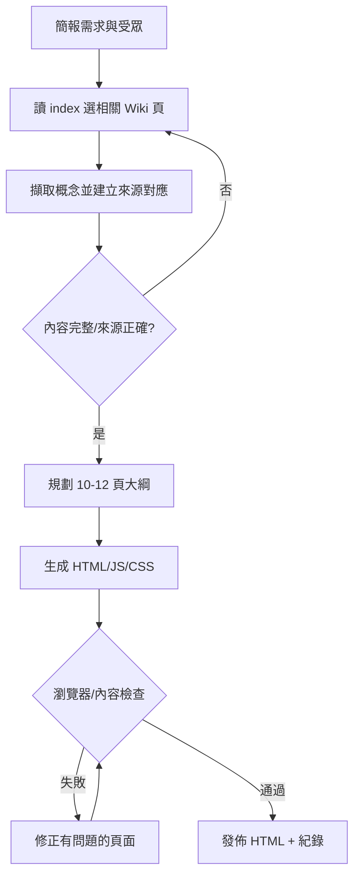

# 作業 Workflow / Graph：資料 → Wiki → 教學 HTML

## A. 建立及維護 Wiki（已做第一次 ingest）

**已執行**：主題確認、選五篇、讀取與整理、建立來源頁、整合概念頁及交叉連結。  
**需區分**：以上是人工引導的 LLM 整理步驟，不代表已寫好一個持續自動運行的 Agent。檢查腳本結果另見品質檢核。  
**可重複**：每收到新來源重做 C→G；資料衝突時退回 C，新增版本化來源再調整 Wiki。  
**為何這樣設計**：先進 Wiki 的累積知識，再從 Wiki 產生簡報，避免每次重新閱讀散亂的原始資料。

## B. Wiki → HTML 簡報（第一版已產出與測試）

**哪個位置要檢查？** 在寫 HTML 前，先做來源與知識完整性檢查；寫完 HTML 再做顯示／互動檢查。  
**為什麼前移？** 避免前面的內容錯誤被完整排版包裝後才發現，降低重做成本。  
**自動還是人工？** 本次已依此設計產出 12 頁 HTML 並執行 Playwright 測試。內容組織與源頭檢查是人工引導的 LLM 工作流；瀏覽器測試腳本可重跑，**未實作完全自動的內容修復 Loop**。參見 `experiment-log-2026-11-20.md`。

## 作業反思可觀察的節點

- `讀取來源`：頁面有版本變動，容易把舊版資訊當現行規範。
- `整合概念`：Client 與 Host、Resource 與 Tool 容易混淆。
- `HTML 顯示`：可能有 CSS 溢出或導航按鈕失效。

目前這三項**只是預判風險**，不能當成已發生的實驗事實。真實實驗要填 [紀錄範本](experiment-template.md)。
